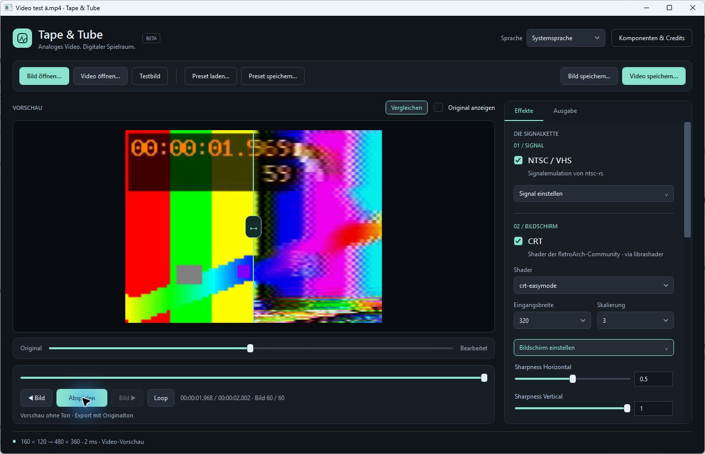

# Tape & Tube

**A Windows adaptation of [NTSCRT](https://github.com/finnmckenty/NTSCRT) by Finn McKenty.** Tape & Tube brings NTSCRT’s core NTSC/VHS → CRT workflow to Windows, using **ntsc-rs**, **librashader** and **RetroArch community shaders**.



**Development beta · Windows x64 · GPL-3.0-only for our own code**

[Deutsche Dokumentation](docs/README.de.md) · [Third-party credits](THIRD_PARTY.md) · [Release notes](CHANGELOG.md)

## Origin: NTSCRT

[NTSCRT](https://github.com/finnmckenty/NTSCRT) is the original macOS application and the starting point for this project. Finn McKenty’s concept, signal-chain organization and media-editing workflow shaped Tape & Tube, including the choice of NTSC/VHS processing and CRT shader families.

Tape & Tube reimplements that core workflow in C#/WPF with a Rust host wrapper for Windows. Its application and host code are newly written; the original Swift/Metal implementation is not included. The current Windows adaptation covers a subset of NTSCRT’s features. The original project remains the reference for its broader feature set.

Credit for the original application concept and workflow belongs to **Finn McKenty / NTSCRT**; credit for signal processing and CRT rendering belongs to the upstream projects named below.

## What it does

- NTSC/VHS signal processing with upstream ntsc-rs controls.
- Seven tested CRT presets: easymode, aperture, hyllian, royale, crtglow_gauss, crtglow_lanczos and crtsim, executed through librashader/Direct3D 11.
- Open still images or videos; preview, seek, step frames and loop playback.
- Compare original and processed frames using a draggable divider, including during video playback.
- Save PNG images or H.264 MP4 video with synchronized original audio (first audio track, encoded as AAC).
- Output at 720p, 1080p, 4K or custom dimensions, with letterboxing or centered cropping.
- Load/save effect presets. Choose between ten UI languages or automatic system-language detection.

Effect processing comes from the upstream projects. Tape & Tube supplies the Windows interface, host boundary, playback/export orchestration, output composition and presets. The adaptation follows NTSCRT’s core workflow; the Windows implementation is newly written.

## Availability

**[Download the Windows x64 beta installer](https://github.com/emgeka/tape-and-tube/releases/tag/v0.1.0-beta.1)** or browse the [releases](https://github.com/emgeka/tape-and-tube/releases). Version **0.1.0-beta.1** includes the installer and matching application source. Install for your current Windows user, then start Tape & Tube from the Start menu. The app includes .NET; you do not need the development tools below to run it.

Setup checks the required Visual C++ x64 and legacy DirectX components and offers official Microsoft download links if they are missing. FFmpeg and ffprobe are optional external tools for video; setup can copy an existing pair you select. See [installer details](docs/INSTALLER.md).

This is an **unsigned early beta**. Installation, Start menu launch, images, video opening and uninstallation were tested in a Windows 11 VM with prerequisites already installed. Detection/installation of missing prerequisites on a fresh VM is still unverified. **VirtualBox CRTSim exports can contain black frames; the same original/preset exported correctly on the physical host.** See [release review](RELEASE_REVIEW.md) for testing and licensing uncertainties.

The repository contains our source and dependency references, not upstream shader collections, downloaded toolchains, FFmpeg binaries or personal media/configuration. Building from source downloads the pinned upstream components separately.

## Build and run

Requirements: Windows x64, a Direct3D 11-capable GPU, PowerShell 7, network access for setup, and `tar` supporting 7z archives. Video features additionally need FFmpeg and ffprobe. Node.js is required only for preparing/validating release packages.

From the repository root:

```powershell
./scripts/setup.ps1
./scripts/build.ps1
./Start.ps1 -Demo
```

Setup downloads the pinned .NET SDK, Rust/MinGW toolchain, librashader and shader snapshot into this project. Check the download/build steps in the scripts before running them. Versions are recorded in `global.json`, `dependencies.json`, `native/Cargo.lock` and `src/Ntscrt.Windows/packages.lock.json`.

The reference librashader DLL also needs the Microsoft [Visual C++ x64 Redistributable](https://learn.microsoft.com/en-us/cpp/windows/latest-supported-vc-redist) and [DirectX End-User Runtimes June 2010](https://www.microsoft.com/en-us/download/details.aspx?id=8109), including `D3DX9_43.dll`. These components are not silently installed or copied from this computer. A clean-machine test is still pending.

For video, expose FFmpeg and ffprobe on PATH, place them in `runtime/media/`, or configure their paths as described below. Still images work without them.

## Using the app

Open media from the top toolbar. **Save image…** and **Save video…** are always visible at the top right and become available when suitable media is ready. **Output** in the right sidebar controls dimensions and fit/crop. **Compare** above the preview enables the original/processed divider; exports contain only the processed result.

The top-right language selector offers Deutsch, English, Español, Français, Português (Brasil), Italiano, Русский, 简体中文, 日本語 and 한국어. Changes apply immediately and are saved locally. Automatic selection uses the Windows display language, with English as fallback; Portuguese maps to pt-BR and Chinese to Simplified Chinese. Technical upstream parameter names and original library diagnostics remain unchanged. Native file-dialog controls follow Windows' display language.

**Updates** offers separate **Release** (stable) and **Beta** (stable plus prerelease) channels. A startup check can notify you of newer versions; installation always remains manual. This beta defaults to Beta; stable builds default to Release. Automatic checking can be disabled. See [update channel details](docs/UPDATE_CHANNELS.md).

## External components stay configurable

**Components & credits** lists responsibilities, licenses, source links, tested reference versions and the actual loaded paths. Override defaults using an untracked `components.local.json`:

```json
{
  "shaderRoot": "D:/Shaders/slang-shaders",
  "ffmpeg": "D:/MediaTools/ffmpeg.exe",
  "ffprobe": "D:/MediaTools/ffprobe.exe",
  "shaderPresets": ["crt/crt-easymode.slangp", "crt/crt-royale.slangp"]
}
```

`ntscLibrary` and `librashaderLibrary` are also configurable. Environment overrides: `TAPETUBE_SHADER_ROOT`, `TAPETUBE_NTSC_LIBRARY`, `TAPETUBE_LIBRASHADER_LIBRARY`, `TAPETUBE_FFMPEG`, `TAPETUBE_FFPROBE`. Relative paths resolve against the project/package root. Our native wrapper requires host API 1; librashader requires ABI 2. A generic ntsc-rs plugin is not a substitute for our host DLL. Replacement components need their own compatibility and licensing checks.

Language preferences are stored in `%LOCALAPPDATA%/TapeTube/ui-settings.json`, independently of media and presets.

## Validation

```powershell
./scripts/test.ps1
./scripts/test-video.ps1
./scripts/test-export.ps1
./scripts/test-output.ps1
./scripts/test-language.ps1
./scripts/test-updates.ps1
```

The current suites cover 16 effect checks, 17 video checks, 23 export checks, 30 output/comparison checks, 96 language checks and 17 update-channel checks (199 total). Rendering tests require the native libraries, shader assets and GPU; video/export tests require FFmpeg. Update-channel tests run offline. Local tests do not establish compatibility with every Windows installation.

## Known limits

- Preview is silent; video exports include original audio.
- Preview may skip frames under load. Export processes every frame.
- Variable frame-rate video is normalized to the preview time grid.
- SDR workflow, no dedicated HDR tone mapping.
- Installer included; no code signing. Update notices are automatic when enabled; downloading and installation remain manual.
- VirtualBox CRTSim exports may contain flickering/black frames; physical-host reproduction with the reported source/preset was clean. Virtual GPU export compatibility is not certified.
- Fresh-machine handling of missing Microsoft runtimes remains unverified.
- NTSCRT-specific glitch, keyframe and digital-video effects are outside the current scope.

## Licensing and credits

Our original application code, host integration, scripts and documentation: **GPL-3.0-only**. See [LICENSE](LICENSE) and [COPYRIGHT.md](COPYRIGHT.md). Third-party projects retain their own licenses:

| Component | Responsibility | Upstream license/reference |
| --- | --- | --- |
| [ntsc-rs](https://github.com/ntsc-rs/ntsc-rs) | NTSC/VHS signal processing | MIT OR ISC OR Apache-2.0 |
| [librashader](https://github.com/SnowflakePowered/librashader) | CRT shader execution | C-API 0.12.0 declares MPL-2.0 OR GPL-3.0-only; C header MIT; transitive notices separately documented |
| [RetroArch slang-shaders](https://github.com/libretro/slang-shaders) | CRT effects, masks, scanlines, glow | Varies by file; preserve original notices |
| [FFmpeg](https://ffmpeg.org/) | Media decoding and video/audio encoding | Depends on the separately installed build |
| Vortice.Windows / SharpGen.Runtime | Managed graphics bindings | MIT; see package metadata |

[Full third-party notes](THIRD_PARTY.md). Tape & Tube is not an official release of NTSCRT, ntsc-rs, RetroArch or librashader.
