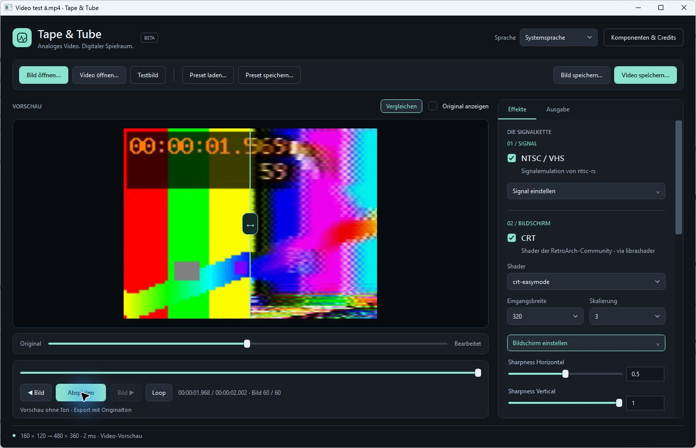

# Tape & Tube — Windows beta

**Windows adaptation of [NTSCRT](https://github.com/finnmckenty/NTSCRT) by Finn McKenty.** The original macOS project is the starting point for the concept, signal chain and workflow; this Windows implementation covers its core NTSC/VHS and CRT stages with newly written application/host code.

**Version 0.1.0-beta.1 — unsigned early beta.**

## Start

Run the Windows x64 installer and start **Tape & Tube** from the Start menu. Setup checks required Microsoft runtimes and offers official download links; missing components are installed separately by you. .NET is included. Optional FFmpeg selection copies your chosen existing tools. The installer includes matching own source under `sources`. If using a portable ZIP, extract it completely into a writable folder and keep the DLLs, assets, metadata and notices together.

The reference librashader binary also imports Microsoft Visual C++ runtime DLLs (`MSVCP140`, `VCRUNTIME140`, `VCRUNTIME140_1`) and legacy `D3DX9_43.dll`, even though this app uses Direct3D 11. A computer missing these components needs the official Microsoft [Visual C++ x64 Redistributable](https://learn.microsoft.com/en-us/cpp/windows/latest-supported-vc-redist) and [DirectX End-User Runtimes June 2010](https://www.microsoft.com/en-us/download/details.aspx?id=8109). They are not copied from this computer or silently installed. A future D3D11-only library build should remove unnecessary legacy dependencies.

Select **Testbild** to try the effects immediately. Use **Bild öffnen…** or **Video öffnen…** for your own material. The interface supports ten selectable languages; see Language below.

**Komponenten & Credits** identifies the external projects and their responsibilities, tested reference versions, licenses, source links and actual loaded paths. Personal overrides belong in `components.local.json`; the shared `components.json` documents defaults. You can point to other compatible libraries, another shader collection and additional shader presets without modifying application code. See the source README for the options and ABI requirements.

## Video tools

Video preview and MP4 export additionally require **FFmpeg** and **ffprobe**. This review ZIP does not redistribute the computer's installed FFmpeg build. Either make an existing installation available on PATH, or place `ffmpeg.exe` and `ffprobe.exe` in the included `runtime/media/` folder. `TAPETUBE_FFMPEG` and `TAPETUBE_FFPROBE` can also point to these executables.

Still-image processing works without FFmpeg. Video preview is silent; MP4 exports include the first audio track from the original video.

## Output size

Choose **Ausgabegröße** in the **Ausgabe** tab on the right: automatic, 720p, 1080p, 4K or custom dimensions. **Einpassen** preserves the whole image with black borders. **Ausfüllen** fills the output with a centered crop. PNG dimensions are exact; MP4 pads odd dimensions by at most one pixel for H.264.

## Limits

- Windows x64 with a Direct3D 11 capable GPU. Other systems and GPUs still need independent testing.
- 4K effects may be slower than real time; video export renders every frame.
- Variable frame rates are normalized to the preview frame rate.
- SDR workflow; no dedicated HDR tone mapping.
- Unsigned beta. Release/Beta update notices can be checked automatically at startup; the user opens the download page and installs updates manually. Disable automatic checking under Updates if desired.
- VirtualBox CRTSim exports may contain black/flickering frames; the reported original/preset exported correctly on physical hardware.
- Missing-prerequisite handling on a fresh VM remains unverified. Installation/start/uninstallation with existing prerequisites have been tested.

## Licensing and review status

Our original code is **GPL-3.0-only** (`LICENSE`, `COPYRIGHT.md`). Included third-party files retain their own licenses. The corresponding own application source is supplied in the companion source ZIP. The `licenses` directory and `THIRD_PARTY.md` identify upstream components.

This bundle retains all seven selected CRT presets, unchanged shader files and original notices. Some upstream scopes are not explicitly documented, particularly Glow. The project owner accepts these transparent uncertainties following upstream practice; individual retrospective confirmations are not a release prerequisite. See `licenses/SHADER_LICENSE_REVIEW.md` and `assets/slang-shaders-selected/asset-manifest.json`. Third-party licenses are unchanged. Remaining library notice gaps are listed in `licenses/README.md`; the native dependency inventory is not yet complete.

Original application concept and workflow: NTSCRT by Finn McKenty. Signal emulation comes from ntsc-rs; CRT effects come from the RetroArch shader community and run through librashader. Tape & Tube is an independent project, not an official release of those projects.

## Language

The language selector in the top right offers **System language** plus German, English, Spanish, French, Portuguese (Brazil), Italian, Russian, Simplified Chinese, Japanese and Korean, shown in their native names. Automatic selection follows the Windows display language, mapping Portuguese to pt-BR and Chinese to zh-Hans. Unsupported languages fall back to English. Your choice is saved for future launches in `%LOCALAPPDATA%/TapeTube/ui-settings.json`. Switching languages preserves the current media and effect settings. Technical effect names and original library messages remain unchanged; native Windows file-dialog controls follow the Windows display language.
