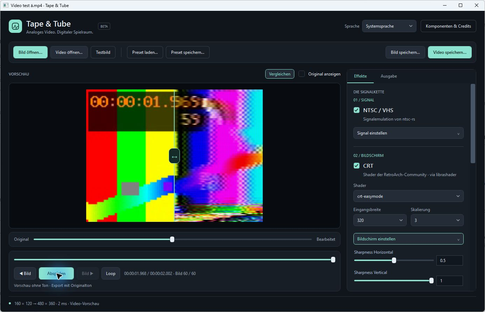

# Tape & Tube — Windows-Beta

**Lokaler Entwicklungsstand vom 20.11.2026:** Digitalvideo aus Finn McKentys NTSCRT ist in Vorschau und Export integriert. Webcam, MiniDV und CD-ROM stehen unter **Effekte → Digitalvideo-Format**. Dies gehört noch nicht zum öffentlichen Beta.2-Installer. [Bedienung, Herkunft und Tests](DIGITAL_VIDEO_INTEGRATION.md).



**Windows-Adaption von [NTSCRT](https://github.com/finnmckenty/NTSCRT) von Finn McKenty.** Das ursprüngliche macOS-Projekt ist der Ausgangspunkt unserer Arbeit: Konzept, Aufbau der NTSC-/VHS- und CRT-Signalkette sowie der grundlegende Bedienablauf gehen auf NTSCRT zurück.

Tape & Tube setzt diesen Kern-Workflow mit einer neu geschriebenen Windows-Oberfläche in C#/WPF und einer Rust-Host-Anbindung um. Die Effektimplementierungen stammen aus **ntsc-rs** und den **RetroArch-CRT-Shadern über librashader**. Die Windows-Adaption deckt derzeit einen Teil der NTSCRT-Funktionen ab; der Swift-/Metal-Anwendungscode wird nicht übernommen.

Eigener Code: **GPL-3.0-only**, siehe `LICENSE` und `COPYRIGHT.md`. Die Urheberschaft am ursprünglichen Anwendungskonzept und Workflow liegt bei Finn McKenty / NTSCRT. Die lokale Veröffentlichungsvorbereitung und offene Punkte stehen in `RELEASE_REVIEW.md`.


## Download und Update-Kanäle

Den Windows-x64-Installer findest du unter https://github.com/emgeka/tape-and-tube/releases. Die .NET-Laufzeit ist enthalten. Das Setup prüft C++/DirectX und bietet bei Bedarf offizielle Microsoft-Downloads an. Auf einer gemeinsamen Komponentenseite lässt sich DirectX automatisch herunterladen/entpacken und mit Microsofts sichtbarem DXSETUP installieren. FFmpeg bleibt für Bilder optional: ein geprüftes Paket herunterladen oder eine vorhandene Installation nach Version und Pfad auswählen; externe Dateien werden nicht kopiert.

Oben rechts unter **Updates** wählst du **Release** (stabile Versionen) oder **Beta** (einschließlich Vorabversionen). Die Auswahl bleibt gespeichert. Die App kann beim Start anonym auf GitHub nach neueren Versionen suchen und einen Hinweis zeigen; Download und Installation startest du selbst. Die automatische Prüfung lässt sich dort abschalten. Diese Beta startet im Beta-Kanal; eine stabile Version gibt es noch nicht. Details: [Update-Kanäle](UPDATE_CHANNELS.md).

## Fremdkomponenten und Konfiguration

**Komponenten & Credits** in der App erklärt den Anteil der externen Projekte, nennt ihre Quellen und Lizenzen und zeigt die tatsächlichen Bibliotheks-/Shader-/Medienwerkzeug-Pfade. Referenzversionen stammen aus `dependencies.json`; bei extern ersetzten DLLs wird nicht behauptet, deren Version entspreche automatisch dem getesteten Referenzstand. FFmpeg und ffprobe melden ihre tatsächlich installierte Version.

`components.json` enthält die gemeinsamen Voreinstellungen. Eine eigene Datei **`components.local.json`** kann einzelne Einstellungen überschreiben, ohne Anwendungscode oder die gemeinsamen Vorgaben zu ändern. Sie wird nicht in Quellcode- oder Veröffentlichungspakete aufgenommen. Pfade dürfen relativ zum Projekt-/Paketordner oder absolut sein:

```json
{
  "shaderRoot": "D:/Shaders/slang-shaders",
  "ffmpeg": "D:/MediaTools/ffmpeg.exe",
  "ffprobe": "D:/MediaTools/ffprobe.exe",
  "shaderPresets": ["crt/crt-easymode.slangp", "crt/crt-royale.slangp"]
}
```

Weitere Optionen: `ntscLibrary` und `librashaderLibrary`. Alternativ haben `TAPETUBE_SHADER_ROOT`, `TAPETUBE_NTSC_LIBRARY`, `TAPETUBE_LIBRASHADER_LIBRARY`, `TAPETUBE_FFMPEG` und `TAPETUBE_FFPROBE` Vorrang. Die NTSC-DLL benötigt unsere **Host-API 1**; librashader benötigt die unterstützte **ABI 2**. Ein generisches ntsc-rs-Plugin ist kein Ersatz für diese Host-DLL. Andere kompatible Bibliotheksstände sind technisch einbindbar, aber ihre Bildausgabe muss separat geprüft werden.

`shaderPresets` ist eine Liste relativer oder absoluter `.slangp`-Pfade. So lassen sich andere Presets einer vorhandenen Sammlung einbinden, ohne die Oberfläche umzuschreiben. Die ersten sieben Presets bleiben die getestete Voreinstellung. Fremde Shader werden nicht verändert oder unter unsere Lizenz umgestellt.

## Lokale Veröffentlichungsvorbereitung

`./scripts/package.ps1` erstellt eine portable Windows-x64-Ausgabe mit .NET-Laufzeit, eine bereinigte Quellcode-ZIP und Prüfsummen unter `artifacts/releases/`. Nach einmaligem Laden der Laufzeitpakete ist `-Offline` möglich. Der Pfad des jüngsten Pakets steht in `runtime/current-release.txt`.

Für das Erstellen der Veröffentlichungspakete ist zusätzlich Node.js erforderlich (Sammeln der Shader und Abhängigkeitsinformationen). Die fertige Anwendung benötigt Node.js nicht.

Der Stand wird als ausdrücklich gekennzeichnete **Beta mit Quellcode und Windows-Installer** veröffentlicht. Der aktuelle VM-Installationstest und der neueste Export waren erfolgreich, ohne Flackern oder schwarze Bilder. Frühere CRTSim-Probleme wurden dabei nicht reproduziert; ihre Ursache gilt weiterhin als ungeklärt. Einzelne fehlende-Komponenten-/Abbruchpfade sind nicht separat als getestet protokolliert. Ausgewählte Original-Shader werden einschließlich ihrer Dateien und vorhandenen Hinweise gesammelt; ungeklärte Lizenz-/Texturfragen werden im Prüfbericht nicht als gelöst ausgegeben. FFmpeg und persönliche Pfadkonfigurationen werden nicht mitkopiert. Weitere Angaben stehen in `RELEASE_README.md` und `RELEASE_REVIEW.md`.

`./scripts/test-package.ps1` entpackt die Ausgabe separat, prüft die enthaltene Laufzeit und die bereinigte Quellcode-ZIP, führt die vier Effekttests aus und testet zusätzlich eigene Bibliotheks-/Shaderpfade. Mit `-QaRoot` kann ein Verzeichnis außerhalb des Projekts gewählt werden. Der Test bestätigt den Paketbetrieb auf diesem Rechner; er ersetzt keinen Test auf einem frisch eingerichteten zweiten PC. Der derzeitige librashader-Build benötigt außerdem Microsoft-Visual-C++- und ältere DirectX-Laufzeitdateien; siehe `RELEASE_README.md`.

## Aktueller Umfang

- PNG, JPEG, BMP und TIFF öffnen.
- Originale NTSC-/VHS-Verarbeitung; Regler werden aus dem ntsc-rs-Schema erzeugt.
- Sieben CRT-Presets: easymode, aperture, hyllian, royale, crtglow_gauss, crtglow_lanczos, crtsim.
- CRT-Eingangsauflösung und Ausgabegröße einstellen; Shaderparameter bearbeiten.
- Verarbeitete Vorschau, Originalansicht, PNG-Export und eigene JSON-Presets.
- Videos öffnen, mit fortlaufenden NTSC-/CRT-Effekten abspielen und pausieren.
- Zeitleiste, Vor-/Zurück um ein Bild und PNG-Export des gewählten Videobildes.
- Loop-Schaltfläche zum Wiederholen der Video-Vorschau.
- MP4-Export (H.264, hohe Qualität) mit der ersten Original-Tonspur als AAC, Fortschrittsanzeige und Abbruch.
- Gemeinsame Ausgabegrößen für PNG und MP4: 720p, 1080p, 4K und eigene Maße; Einpassen mit schwarzen Rändern oder mittiger Beschnitt.
- Hintergrundberechnung mit verzögerter Aktualisierung beim Verschieben von Reglern.

Standbilder verwenden eine feste Frame-Nummer. Bei Videos folgen die Effekte der gewählten Videoposition. **Die Vorschau ist weiterhin ohne Ton; der MP4-Export enthält den Originalton.** Ein Windows-x64-Installer ist enthalten. NTSCRT-eigene Digitalvideo-, Glitch-, Screen-Loop- und Keyframe-Funktionen gehören nicht zum aktuellen Umfang.

## Starten

`Start.ps1` öffnet die zuletzt erfolgreich gebaute Version. Deren Ordner steht in `runtime/current-app.txt`. Neue Builds liegen getrennt unter `artifacts/builds/`, damit eine noch laufende ältere Version und ihre ungespeicherten Einstellungen beim Bauen erhalten bleiben.
Sie benötigt die Ordnerstruktur dieses Projekts und die enthaltenen Runtime-DLLs. Noch kein eigenständiges Installationspaket.

Alternativ in PowerShell im Projektordner:

```powershell
./Start.ps1
./Start.ps1 -Demo
```

Mit `-Demo` wird ein generiertes Testbild geladen. Transparente Bilder werden auf Schwarz zusammengesetzt.

## Oberfläche

Die große Vorschau steht links; **Original anzeigen** schaltet zum Vergleich auf die Quelle um. Rechts enthält **Effekte** die Signalstufen NTSC/VHS und CRT mit aufklappbaren Reglerlisten. **Ausgabe** bündelt Größe und Bildanpassung. **Bild speichern…** und **Video speichern…** stehen immer sichtbar oben rechts in der Werkzeugleiste. Die Breite der Seitenleiste lässt sich an der Trennlinie zur Vorschau anpassen. Bild, Video und Presets werden über die obere Werkzeugleiste geöffnet bzw. gespeichert.


**Vorher/Nachher:** Mit **Vergleichen** oberhalb der Vorschau werden links das Original und rechts die bearbeitete Ausgabe gleichzeitig sichtbar. Den vertikalen Trenner direkt im Bild ziehen oder den Regler darunter verwenden (auch per Pfeiltasten, Pos1/Ende). Das funktioniert bei Bildern und während der Video-Wiedergabe; beide Seiten zeigen dieselbe fertig berechnete Bildposition. Ausgabegröße, Einpassen und Beschnitt gelten für beide Seiten. **Original anzeigen** und der geteilte Vergleich schließen einander aus. Gespeicherte PNGs und MP4s enthalten ausschließlich die bearbeitete Ausgabe, ohne Trenner oder Vergleichsansicht.

Mit dem **Zoom**-Regler unter dem Bild oder dem Mausrad kannst du die Vorschau bis auf 800 % der eingepassten Ansicht vergrößern. Ziehe das vergrößerte Bild mit der linken Maustaste, um den sichtbaren Bereich zu verschieben. Im Vorher-nachher-Vergleich bewegen sich beide Bilder gemeinsam. **Ansicht einpassen** zeigt wieder das ganze Bild. Zoom und Verschieben wirken nur auf die Vorschau.

**Ganzzahlskalierung** richtet die Scanlines in der Vorschau auf ganze physische Bildschirmzeilen aus. Die Anzeigegröße ändert sich beim Zoomen dann in Stufen. Ist das Bild für eine ganze Bildschirmzeile pro Scanline zu groß, wird es weiterhin vollständig eingepasst. Die Option startet ausgeschaltet und wirkt nur auf die Vorschau.

Während ein Video pausiert, berechnet Tape & Tube bis zu zwölf Folgebilder für die Vorschau. Der Puffer ist auf 96 MiB für Quell- und Effektbilder begrenzt und fasst bei hoher Auflösung entsprechend weniger Bilder. Die Zahl der vorbereiteten Bilder steht beim Player. Beim Fortsetzen verwendet die Vorschau diese Bilder zuerst. Positionssprünge und Änderungen an den Effekten, am Beschnitt oder an den Ausgabemaßen leeren den Puffer.

Bei einem Standbild ohne aktive Animation kannst du unter der Vorschau **Störeffekte bewegen** einschalten. Rauschen und andere zeitabhängige Effekte laufen dann mit bis zu 30 Bildern pro Sekunde. **Bild speichern…** sichert das beim Klick aktuelle Effektbild als PNG. Für einen animierten Export verwendest du weiterhin die Zeitleiste oder Screen Loop.

## Sprache

Oben rechts stehen **Systemsprache** und zehn Sprachen zur Auswahl: Deutsch, English, Español, Français, Português (Brasil), Italiano, Русский, 简体中文 (vereinfachtes Chinesisch), 日本語 und 한국어. Die automatische Auswahl folgt der Windows-Anzeigesprache einschließlich regionaler Varianten; Portugiesisch wird pt-BR, Chinesisch wird zh-Hans zugeordnet. Für nicht unterstützte Sprachen wird Englisch verwendet. Die manuelle Wahl wird unter `%LOCALAPPDATA%/TapeTube/ui-settings.json` für künftige Starts gespeichert. Sie ist unabhängig von Medien, Presets und Komponentenpfaden.

Der Wechsel wirkt sofort und erhält das geladene Medium und die Effektwerte. Menüs, Hinweise, Status, Fortschritt und Credits sind übersetzt. Technische Effektparameter und originale Bibliotheksmeldungen bleiben im Original. Die Bedienelemente der nativen Windows-Dateidialoge folgen weiterhin der Windows-Sprache; Titel und Dateityptexte folgen der App-Sprache. Die zentralen Texte stehen in `src/Ntscrt.Windows/Translations.json` und werden in die Anwendung eingebettet. Alle zehn Sprachen haben einen vollständigen Katalog für die eigenen Anwendungstexte. Fachbegriffe aus den Fremdprojekten bleiben im Original.

`./scripts/test-language.ps1` prüft automatische Auswahl, Fallback, sofortige Aktualisierung der Sprachressourcen, unveränderte Zahlenkultur, Übersetzungsplatzhalter und das Speichern/Laden einschließlich defekter Einstellungsdateien.

## Ausgabegröße

Im rechten Reiter **Ausgabe** befindet sich **Ausgabegröße**. Die Schaltflächen für PNG und MP4 stehen oben rechts in der Werkzeugleiste. Die Auswahl gilt gleichermaßen für Vorschau, PNG und MP4:

- **Wie Vorschau** erhält die bisherige automatische Größe: ohne CRT die Quellauflösung, mit CRT die verkleinerte CRT-Eingangsauflösung multipliziert mit dem CRT-Skalierungsfaktor.
- **720p**, **1080p** und **4K** verwenden feste Maße von 1280 × 720, 1920 × 1080 beziehungsweise 3840 × 2160.
- **Eigene Maße** erlaubt eigene Breite und Höhe, etwa 1080 × 1920 für Hochkant. Zulässig sind ganze Zahlen von 1 bis 8192 Pixeln und zusammen höchstens 24 Megapixel.
- **Einpassen · schwarze Ränder** zeigt das vollständige Bild mit unverändertem Seitenverhältnis und ergänzt bei Bedarf Ränder.
- **Ausfüllen · mittig beschneiden** füllt das Zielformat ohne Verzerrung; überstehende Bildteile werden mittig abgeschnitten.

Die tatsächlichen Maße für PNG und MP4 stehen direkt darunter. PNG behält auch ungerade eigene Maße exakt bei; MP4 ergänzt nötigenfalls rechts beziehungsweise unten einen Randpixel für gerade Kodiermaße. Ungültige Maße sperren den Export, bis sie korrigiert sind.

**Am Scanline-Raster ausrichten** passt auf Wunsch die Ausgabegröße an, damit jede Scanline auf gleich viele Pixelzeilen fällt. Das Raster richtet sich nach dem Quellausschnitt und der internen Effektauflösung. Einpassen und Beschnitt gelten weiterhin. Die aktualisierten Maße stehen unter der Option und gelten auch für die Vorschau. Wenn kein passendes Vielfaches innerhalb der unterstützten Maße liegt, bleibt die gewählte Ausgabegröße erhalten. GIFs mit automatischer Größe halten dabei weiterhin die Grenze von 480 Pixeln an der längsten Seite ein.

Die **Interne Effektbreite** unter **Effekte → Verarbeitung** bestimmt die Retro-Auflösung und den Effektcharakter. Die Skalierung unter **Effekte → CRT → Details** steht bei automatischer Ausgabegröße zur Verfügung. Bei einer festen Ausgabegröße rendert der CRT-Shader unmittelbar in der für das Ziel benötigten Auflösung, damit Phosphormaske und Scanlines nicht bloß aus einem kleinen fertigen Bild hochskaliert werden. Die Vorschau berechnet ebenfalls diese Auflösung; 4K kann daher langsamer sein. Extrem große Beschnitt-Zwischenbilder werden auf die vorhandenen Textur- und Speichergrenzen begrenzt und anschließend angepasst.

Unter **Effekte → Verarbeitung → Skalierungsmethode** kannst du für eigene Looks zwischen **Nächster Nachbar**, **Nächster Nachbar (stabilisiert)**, **Bilinear**, **Bikubisch**, **Lanczos** und **Flächenmittel** wählen. **Automatisch** verwendet das bisherige Verhalten des Looks. Die Wahl gilt für die interne Effektauflösung und wird im Look-Preset mitgespeichert. Vorschau, Export, CLI und MCP übernehmen die gespeicherte Methode.

**Effekte → Verarbeitung → Interne Verkleinerung** bietet **Automatisch**, **Ein** und **Aus**. **Automatisch** behält die bisherigen Regeln bei. Mit **Ein** gilt die gewählte interne Breite auch ohne CRT oder andere Effekte. Mit **Aus** wird die Verkleinerungsstufe übersprungen. Die übrigen Effekte und die separate Ausgabegröße gelten weiterhin. Eigene Looks speichern die Auswahl für Vorschau und Export.

Die Ausgabegröße und die Bildanpassung werden in eigenen Presets mitgespeichert. Bisherige Presets ohne diese Felder laden weiterhin mit automatischer Ausgabegröße.

## Effekte und NTSCRT-Looks

Unter **Effekte → Quellbeschnitt** legst du das Seitenverhältnis und den Ausschnitt fest. **Horizontal**, **Vertikal** und **Quellzoom** ändern seine Position und Größe. Der Ausschnitt wird vor dem ersten Effekt auf Bilder und jedes Videoframe angewendet. Die Vorschau sowie PNG und MP4 verwenden denselben Ausschnitt. **Original anzeigen** zeigt weiterhin die vollständige Quelle. Im Vergleich siehst du links den gewählten Ausschnitt vor den Effekten. Unter **Ausgabe** legst du fest, wie das fertige Bild in die Zielgröße passt.

Im lokalen Entwicklungsbuild startet Tape & Tube mit ausgeschalteten Effekten. Schalte die gewünschten Stufen unter **Effekte** ein. Jede Stufe hat einen einklappbaren Bereich **Details**. Die Karte für Screen Loop befindet sich ebenfalls unter **Effekte**. Beim Laden eines normalen Tape-&-Tube-Presets gelten die darin gespeicherten Schalter. Für Screen Loop gibt es eigene Presets.

Im lokalen Entwicklungsbuild lädt **Preset laden…** normale NTSCRT-Look-Dateien im JSON-Format der Versionen 1 und 2. Die Effekte und Übergänge aus der Datei werden in Vorschau und Export ausgewertet. Auf einem Video verteilt sich die Animation über die Videolänge. Für ein Standbild gelten die in der Datei gespeicherte Dauer und Bildrate.

Die Effekte und der Quellbeschnitt eines importierten Looks sind während der Anwendung schreibgeschützt. **Preset speichern…** speichert den Inhalt des importierten Looks als JSON. **Importierten Look verlassen** führt zu den zuvor eingestellten Effekten und zum vorherigen Quellbeschnitt zurück. NTSCRT-Ansichtseinstellungen bleiben in der JSON-Datei erhalten. Die Vorschau und Ausgabegröße bestimmst du in Tape & Tube.

## Eigene Keyframes

Lade ein Bild oder Video und wähle **Animation → Animation aktivieren**. Wähle auf der Zeitleiste ein Bild und klicke **Keyframe hier speichern**. Damit hältst du die aktuellen Effektwerte an dieser Position fest. Markierungen unter der Zeitleiste zeigen die gespeicherten Positionen. Bei einem Standbild kannst du die Dauer zwischen 0,5 und 120 Sekunden und die Bildrate auf 12, 24, 30 oder 60 Bilder pro Sekunde einstellen. Zeitabhängige Effekte wie NTSC-Rauschen lassen sich auch ohne Keyframes animieren und über **Video / GIF speichern…** exportieren.

Die Liste **Gespeicherte Keyframes** springt zum gewählten Keyframe. **Werte bearbeiten** lädt dessen Werte in die Effektregler. **Regler live prüfen** zeigt beim Pausieren die aktuellen Reglerwerte. Mit **Keyframe hier speichern** übernimmst du sie an der gewählten Position. Wähle für jeden Keyframe, wie er in den nächsten übergeht. Der gesamte Track wird mit **Preset speichern…** in einem Tape-&-Tube-Preset gespeichert und beim MP4-Export verwendet.

Die Schalter der Effektstufen, der gewählte Shader und die Größen gelten für die ganze Animation. Die Auswertung nutzt die Übergänge von NTSCRT und behandelt strukturelle Digitalvideo-Einstellungen wie Codec und Bildrate als feste Einstellungen. Ein aktiver Screen Loop oder ein importierter NTSCRT-Look pausiert den eigenen Track.

## Kommandozeile

`TapeTube.Cli.exe` liegt im Windows-Build neben `TapeTube.exe`. `describe` listet die Ausgabeformate, CRT-Shader und Digitalvideo-Formate als JSON. `render` verwendet dieselbe Effekt- und Exportberechnung wie die App. Die Dateiendung wählt PNG, MP4 oder GIF.

```powershell
.\TapeTube.Cli.exe describe
.\TapeTube.Cli.exe describe digital
.\TapeTube.Cli.exe describe crt --shader crtsim
.\TapeTube.Cli.exe render --input "clip.mp4" --output "fertig.mp4" --preset "look.json" --codec hevc --quality very-high
.\TapeTube.Cli.exe render --input "clip.mp4" --output "drei-durchlaeufe.mp4" --loops 3
.\TapeTube.Cli.exe render --input "clip.mp4" --output "scanlines.png" --width 1920 --height 1080 --snap
.\TapeTube.Cli.exe render --input "clip.mp4" --output "animation.gif" --gif-width 640 --gif-fps 24
.\TapeTube.Cli.exe render --input "clip.mp4" --output "vhs.mp4" --effects '{"ntsc":{"values":{"composite_noise":true,"composite_noise_intensity":0.35}}}'
.\TapeTube.Cli.exe render --input "clip.mp4" --output "fertig.mp4" --preset "look.json" --width 961 --height 541 --dry-run
.\TapeTube.Cli.exe render --input "clip.mp4" --output "bild.png" --frame 120 --width 960 --height 540
.\TapeTube.Cli.exe render --input "clip.mp4" --output "bilder.png" --time "0,1.5,3"
.\TapeTube.Cli.exe render --input "clip.mp4" --output "nahaufnahme.png" --frame 120 --zoom 4 --zoom-at "0.75,0.25"
.\TapeTube.Cli.exe render --input "bild.png" --output "animation.gif" --preset "look.json" --seconds 3 --fps 24
```

Unterstützt werden Tape-&-Tube-, NTSCRT- und Screen-Loop-Presets. Eine PNG-Ausgabe aus einem Video verwendet das mit `--frame` gewählte Bild ab Index 0. Breite und Höhe werden gemeinsam angegeben. Vorhandene Dateien lassen sich mit `--overwrite` gezielt ersetzen. Die Kommandozeile schreibt das Ergebnis als JSON in die Standardausgabe und Fehler in die Fehlerausgabe. `--help` listet alle Optionen.

`--dry-run` liest die Quelldaten für Bildgröße und Zeitbasis, löst Preset und Effektparameter auf und zeigt das geplante Format, die Maße und die Dauer als JSON. MP4-Durchläufe, gerade MP4-Kodiermaße, GIF-Bildrate und das Scanline-Raster fließen in das Ergebnis ein. Der Probelauf schreibt keine Datei und meldet, ob Ziel und Zielordner vorhanden sind. Die Berechnung der Effekte und die Prüfung des Encoders erfolgen beim tatsächlichen Export.

`--time` exportiert bis zu 256 PNGs an Zeitpunkten in Sekunden. Jeder Zeitpunkt wird dem nächstliegenden Bild zugeordnet. Liegt er hinter dem Ende, wird das letzte Bild verwendet. Bei mehreren Zeitpunkten bekommt jede Datei eine laufende Nummer und die Frame-Nummer, etwa `bilder-001-frame-000000.png`. Bei einem einzelnen Zeitpunkt gilt der angegebene Ausgabename. Die JSON-Ausgabe und der Probelauf führen die Dateien in der Reihenfolge der Anfrage auf. Bei Standbildern gelten Dauer und Bildrate der Animation.

Mit `--zoom` (1× bis 12×) exportierst du eine Nahaufnahme des fertig berechneten PNG-Bildes. `--zoom-at X,Y` wählt den Mittelpunkt des Ausschnitts zwischen `0,0` (links oben) und `1,1` (rechts unten). Standard ist die Bildmitte. Die Bildmaße bleiben gleich und die Pixel werden ohne Glättung vergrößert. Der Probelauf zeigt die genauen Ausschnittsmaße.

`describe` liefert ohne Argumente eine Übersicht. Für Parameter und Standardwerte wählst du `processing`, `ntsc`, `digital`, `vcr`, `reception`, `crt`, `screen-loop` oder `all`. Bei CRT zeigt der Katalog die im jeweiligen Shader deklarierten Startwerte, Bereiche und Schrittweiten. Mit `--shader` lässt sich der CRT-Katalog auf einen installierten Shader eingrenzen.

Mit `--effects` kannst du Effekte für einen einzelnen Renderauftrag einschalten und deren Werte direkt setzen. Das funktioniert mit einem Tape-&-Tube- oder Screen-Loop-Preset sowie ohne Preset. Importierte NTSCRT-Looks bleiben schreibgeschützt. Die Preset-Datei bleibt unverändert.

- Verwende `ntsc`, `digital`, `vcr`, `reception`, `crt` oder `screenLoop` mit `enabled` und einem optionalen Objekt `values`. Einzelne Werte schalten ihre Stufe automatisch ein, sofern du `enabled` leer lässt. Parameter-IDs und Wertebereiche findest du über `describe`.
- Mit `digital.format` wählst du ein Digitalvideo-Format wie `minidv`. Mit `crt.shader` wählst du einen installierten Shader wie `crtsim`.
- `processing` akzeptiert `mode` (`auto`, `on` oder `off`), `width` (16–1280) und `method` aus dem Katalog. Direkte Parameterwerte gelten im gesamten Renderauftrag, auch an vorhandenen Keyframes.

## Lokaler MCP-Server

Ein MCP-Client kann `TapeTube.Cli.exe mcp` als lokalen Prozess über seine Standardein- und -ausgabe (`stdio`) starten. In Clients mit einer `mcpServers`-Konfiguration sieht der Eintrag beispielsweise so aus. Ersetze den Beispielpfad durch den absoluten Pfad zu deiner `TapeTube.Cli.exe`.

```json
{
  "mcpServers": {
    "tape-and-tube": {
      "command": "C:/Apps/TapeTube/TapeTube.Cli.exe",
      "args": ["mcp"]
    }
  }
}
```

Das Werkzeug `describe` listet Ausgabeformate, MP4-Codecs und Qualitätsstufen, CRT-Shader und Digitalvideo-Formate. `render` exportiert PNG, MP4 oder GIF, je nach Endung von `output`. Bei MP4 kannst du mit `codec: "hevc"` H.265 und mit `quality: "very-high"` die Qualitätsstufe **Sehr hoch** wählen. Die weiteren Stufen heißen `standard`, `high` (Voreinstellung) und `maximum`. Gib für `input`, `output` und das optionale `preset` absolute Dateipfade an. `overwrite` muss ausdrücklich `true` sein, um eine vorhandene Zieldatei zu ersetzen. Der Server verarbeitet jeweils einen Renderauftrag.

`describe` akzeptiert optional `stage` und `shader`. Eine Abfrage mit `{"stage":"crt","shader":"crtsim"}` liefert die Regler für CRTsim. Mit `{"stage":"all"}` erhältst du den gesamten Effektkatalog.

`render` akzeptiert dieselben direkten Effektwerte als Objekt `effects`. Ein Beispiel ist `"effects":{"digital":{"format":"minidv"},"crt":{"shader":"crtsim"}}`.

Bei `dryRun: true` liefert `render` den gleichen Probelauf wie die Kommandozeile.

Mit `times: [0, 1.5, 3]` kannst du für PNG dieselben Zeitpunkte angeben. Wähle entweder `times` oder den einzelnen Frame mit `frame`.

Für eine PNG-Nahaufnahme verwendest du beispielsweise `zoom: 4` und `zoomAt: [0.75, 0.25]`. Das funktioniert für einzelne Positionen und für die ganze PNG-Serie.

Für Videoquellen zählt `loops` die Durchläufe im exportierten MP4. Mit `loops: 3` erscheinen Bild und Ton dreimal in derselben Datei.

Mit `snap: true` wird die Ausgabe an das Scanline-Raster angepasst. Die Rückgabe enthält die tatsächliche Breite und Höhe.

Für GIFs legen `gifWidth` und `gifFps` die Ausgabe unabhängig von den MP4-Maßen und der Bildrate der Standbild-Zeitleiste fest.

## Animiertes GIF exportieren

Wähle **Video / GIF speichern…** und im Speicherdialog **Animiertes GIF**. Die Option steht für Videos und für Standbilder mit aktiver Animation oder aktivem Screen Loop zur Verfügung. Der Export übernimmt Quellbeschnitt und Effekte und wiederholt das GIF endlos.

Unter **Ausgabe → GIF** kannst du **64–1920 Pixel Breite** und **1–50 Bilder pro Sekunde** wählen. Die Höhe folgt dem Seitenverhältnis des Quellausschnitts. Das optionale Scanline-Raster kann die Maße weiter anpassen. Die GIF-Einstellungen wirken auf den Export aus Videos und aus animierten Standbildern.

Bei leerer GIF-Breite gilt die allgemeine Ausgabegröße. Steht sie auf **Wie Vorschau**, ist die längste GIF-Seite auf 480 Pixel begrenzt. Bei leerer GIF-Bildrate verwendet der Export die bisherige Automatik mit bis zu 12,5 Bildern pro Sekunde. Eine gewählte höhere Bildrate kann vorhandene Bilder wiederholen. GIF hat keine Tonspur.

Sobald ein Video oder ein animiertes Standbild geladen ist, zeigt der GIF-Bereich die geschätzte Dateigröße und die Bildmaße. Bei einer Schätzung über 10 MB erscheint ein Hinweis. Wie groß die Datei tatsächlich wird, hängt vom Bildinhalt und von der Kompression ab.

## Video-Vorschau

Unter **Effekte → Screen Loop** findest du NTSCRTs Video-Rückkopplung. Nach dem Laden eines Bilds oder Videos kannst du den Modus einschalten oder unter **Details** eines der fünf mitgelieferten Presets auswählen. Der Player zeigt den berechneten Loop. Bei einem Standbild ist die Dauer zwischen 0,5 und 60 Sekunden einstellbar. **Video speichern…** erstellt ein MP4 und übernimmt bei Videos die vorhandene Tonspur.

Ziehe den **grünen Punkt** im bearbeiteten Vorschaubild, um den Fluchtpunkt zu verschieben. Ziehe den **blauen Ring**, um das Ziel seiner Bewegung zu setzen. Ziehe den Ring zurück auf den Punkt, um die Bewegung aufzuheben. Mit den Pfeiltasten kannst du einen fokussierten Griff fein verschieben. Ein Doppelklick oder **Pos1** zentriert den grünen Punkt beziehungsweise setzt den blauen Ring zurück. Änderungen über die Griffe werden in den Reglern und im Screen-Loop-Preset übernommen.

Screen Loop verwendet die aktuelle NTSC-, VCR-, Empfangs- und CRT-Kette. Digitalvideo wird währenddessen übersprungen. Voreinstellungen für Screen Loop lassen sich getrennt von normalen Looks im NTSCRT-Format der Version 2 speichern und laden. Die erste Vorschau braucht Vorlauf. Ein Sprung weit nach hinten oder eine Einstellungsänderung an einer späten Position kann wegen der Bildhistorie dauern. Fluchtpunkt und Drift werden in diesem Build mit Reglern eingestellt.

Über **Video öffnen…** ein Video wählen, dann **Abspielen** drücken. **Loop** wiederholt die Vorschau vom Anfang, bis sie pausiert oder Loop ausgeschaltet wird. Die Zeitleiste sowie **◀ Bild** und **Bild ▶** pausieren die Wiedergabe und wählen ein einzelnes Bild. Im lokalen Entwicklungsbuild springen **|◀** und **▶|** direkt zum ersten bzw. letzten Bild. Sobald dessen Effekte fertig berechnet sind, wird **Bild speichern…** oben rechts freigegeben. Während der Wiedergabe bleibt PNG-Export deaktiviert, damit keine unklare Position exportiert wird.

Bei hoher Last kann der bisherige Renderer Bilder überspringen, um der Spielzeit zu folgen. Der neue Renderer verarbeitet die Bilder der Reihe nach, damit Effekte mit Bildhistorie korrekt bleiben. Variable Bildraten werden auf die durchschnittliche Bildrate vereinheitlicht. Die Bildnummern beziehen sich auf dieses Vorschau-Zeitraster. Rotation und Pixel-Seitenverhältnis werden beim Dekodieren berücksichtigt. Im lokalen Entwicklungsbuild werden PQ- und HLG-Videos beim Einlesen automatisch nach SDR umgewandelt. Im Fenstertitel erscheint dann **HDR → SDR**.

Der Dekoder hält nur ein Bild im Cache und streamt die folgenden Bilder. Rückwärtssprünge dekodieren erneut vom Anfang und können deshalb bei langen Videos dauern. Währenddessen bleiben die Bedienelemente nutzbar; ein neuer Suchvorgang bricht den bisherigen ab.

FFmpeg und ffprobe werden als unsichtbare lokale Hilfsprozesse genutzt. Auf diesem Rechner ist FFmpeg bereits vorhanden und in `runtime/media-tools.json` eingetragen. Auf einem anderen Rechner FFmpeg bereitstellen und `./scripts/setup-media.ps1` ausführen. Alternativ `NTSCRT_FFMPEG` und `NTSCRT_FFPROBE` auf die EXE-Dateien setzen oder beide nach `runtime/media/` legen. Es werden keine Videos hochgeladen.

## Videoexport

Unter **Video / GIF speichern…** kannst du im Feld **Dateityp** zwischen H.264 und H.265 (HEVC) wählen. H.264 ist voreingestellt. HEVC benötigt FFmpeg mit dem Encoder `libx265`, der im vom Installer angebotenen FFmpeg-Build enthalten ist. Beide Codecs exportieren MP4 mit 8 Bit, YUV 4:2:0 und SDR BT.709.

Unter **Ausgabe → MP4-Qualität** stehen **Standard**, **Hoch** (Voreinstellung), **Sehr hoch** und **Maximum** zur Wahl. Die Stufen verwenden bei beiden Codecs die CRF-Werte 23, 18, 14 und 10. Höhere Qualität ergibt in der Regel größere Dateien. Die Auswahl gilt für MP4 aus Videos und animierten Standbildern.

Bei einem geladenen Video legt **Ausgabe → MP4-Durchläufe** fest, wie oft Bild und Ton in der Datei hintereinander stehen. Aus einem sechs Sekunden langen Clip werden bei **3×** achtzehn Sekunden. Wählbar sind **1×** (Voreinstellung) bis **50×**. Der Wiederholen-Schalter im Player steuert die Vorschau.

Das gesamte geladene Video wird mit den beim Start gewählten Effekten auf dem gleichen Zeitraster wie in der Vorschau berechnet. Das gilt auch bei variabler Quellbildrate. Der Export übernimmt die erste Tonspur als AAC mit 192 kbit/s. Videos ohne Ton bleiben ohne Ton.

Ein später Toneinsatz bleibt erhalten. Ton vor dem ersten Videobild wird abgeschnitten. Fehlender Ton am Ende wird durch Stille ergänzt. Ungerade Bildmaße erhalten rechts beziehungsweise unten höchstens einen schwarzen Randpixel, damit gerade Kodiermaße entstehen.

Während des Exports sind die Einstellungen gesperrt. Fortschritt und Restzeitschätzung werden angezeigt; **Abbrechen** beendet den Vorgang. Die Ausgabe wird zunächst in einer temporären Datei im Zielordner erzeugt und erst nach erfolgreichem Abschluss unter dem gewählten Namen abgelegt. Bei Abbruch bleibt eine bereits vorhandene Zieldatei unverändert. Das Quellvideo selbst lässt sich nicht als Exportziel wählen. Beim Schließen der App wird ein laufender Export abgebrochen und aufgeräumt.

Die Loop-Schaltfläche betrifft ausschließlich die Vorschau; der Export enthält das Video einmal.

## Bauen

Windows x64, Direct3D-11-fähige Grafikkarte und .NET Desktop Runtime 10 werden vorausgesetzt. Das Setup lädt SDK, Rust, Compiler und Shader lokal nach `.tools` beziehungsweise `assets`. Git muss verfügbar sein. Keine globalen PATH-Änderungen erforderlich.

```powershell
./scripts/setup.ps1
./scripts/setup-media.ps1
./scripts/build.ps1
./scripts/test.ps1
./scripts/test-video.ps1
./scripts/test-export.ps1
./scripts/test-output.ps1
```

Wenn alle Abhängigkeiten bereits geladen sind: `./scripts/build.ps1 -Offline`.

## Prüfung

`--smoke` berechnet ein synthetisches Testbild mit den echten Bibliotheken auf Direct3D 11. Die 16 Prüfungen umfassen unveränderten Bypass, sichtbare NTSC-Verarbeitung, deterministische NTSC-Ausgabe bei fester Frame-Nummer, CRT-Ausgabegröße und -Parameter, nichtleere CRT-Ausgabe, die kombinierte Kette, verlustfreien PNG-Roundtrip, Ablehnung ungültiger Einstellungen und erfolgreiche Ausgabe aller sieben CRT-Presets.

Ergebnisse stehen in `artifacts/smoke.json`; `source.png`, `ntsc.png`, `crt.png` und `combined.png` zeigen die Stufen. Ein erfolgreicher Test belegt noch keine Pixelgleichheit mit der Mac-App oder Kompatibilität mit jeder Grafikkarte.

`--video-smoke` erzeugt kurze Testvideos mit FFmpeg und prüft gebrochene und variable Bildraten, Unicode-Dateipfade, sequenzielles Lesen gegenüber Positionssprüngen, Videoende, Abbruch, Hochkant-Metadaten, zeitabhängige Effekte und den PNG-Export eines Videobildes. Ergebnisse stehen in `artifacts/video-smoke.json` und `artifacts/video-frame.png`.

`--export-smoke` prüft H.264/AAC, tatsächliche Bildanzahl und Bildrate, sichtbare Effektverarbeitung, Farbkennzeichnung, Audio-Zeitversatz und hörbaren Toneinsatz, Videos ohne Ton, variable und gebrochene Bildraten, ungerade Bildgrößen, Fortschritt sowie Abbruch und Schutz vorhandener Dateien. Ergebnisse stehen in `artifacts/export-smoke.json`; Beispiele unter `artifacts/export-fixtures/`.

`--output-smoke` prüft Einpassen und Beschnitt ohne Verzerrung, Ränder, Mittelung feiner Muster beim Verkleinern, Maße und Validierung, Ausgabe unabhängig vom CRT-Skalierungsfaktor, direktes CRT-Rendering in Zielauflösung sowie PNG und MP4 mit festen, ungeraden und Hochkantmaßen. Beispiele bis 4K liegen unter `artifacts/output-fixtures/`, der Bericht in `artifacts/output-smoke.json`.

## Architektur und Versionsstände

- `native/`: kleine eigene C-Schnittstelle um unverändertes ntsc-rs; Einstellungen und Reglerbeschreibungen werden als JSON übertragen. Keine Rust-Panics über die Sprachgrenze.
- `src/Ntscrt.Windows/`: WPF-Oberfläche, Bildimport/-export und serialisierte Effektkette.
- `VideoSource`: FFmpeg-Streaming-Dekoder, FFprobe-Metadaten und abbrechbare Positionssprünge. Decoderzugriffe sowie Grafikzugriffe sind jeweils serialisiert. Die Wiedergabe wird durch eine monotone Uhr gesteuert.
- `VideoExporter`: eigener Dekoder und eigene Effektkette mit eingefrorenen Einstellungen; fortlaufende BGRA-Bilder über eine Pipe an FFmpeg. Ton wird relativ zum ersten Video-Zeitstempel ausgerichtet. Begrenzter Speicherbedarf, keine komplette Bildsequenz auf der Festplatte.
- Die CPU verarbeitet NTSC vor dem GPU-Upload. Dadurch entfällt für Standbilder ein GPU-Readback vor ntsc-rs. Die CRT-Ausgabe wird für Vorschau und PNG wieder ausgelesen.
- `dependencies.json` hält die Ursprungsprojekte und Versionen fest; `native/Cargo.lock` hält die Rust-Abhängigkeiten fest.
- librashader **0.12.0**, ABI 2. Bewusster eigener Ausgangsstand; keine Behauptung identischer Ausgabe zum älteren, von NTSCRT verwendeten Commit.
- Eigene Windows-Presets verwenden die Formatkennung `tape-and-tube`. Der gemeinsame Verarbeitungskern liest die NTSCRT-Looks mit dem Parser und der Keyframe-Auswertung des Originalprojekts.

## Nächster Ausbau

1. Bedienung und Bildqualität anhand echter Bildquellen verbessern; weitere Grafikkarten prüfen.
2. Schnellere Positionssprünge und Vorschau auf längeren Videos verbessern.
3. Exportqualität und weitere Grafikkarten mit realem Material prüfen, anschließend paketierte Windows-Ausgabe.

## Herkunft

Siehe `THIRD_PARTY.md`. Tape & Tube ist eine eigenständig gepflegte Windows-Adaption und keine offizielle Ausgabe der Fremdprojekte.


