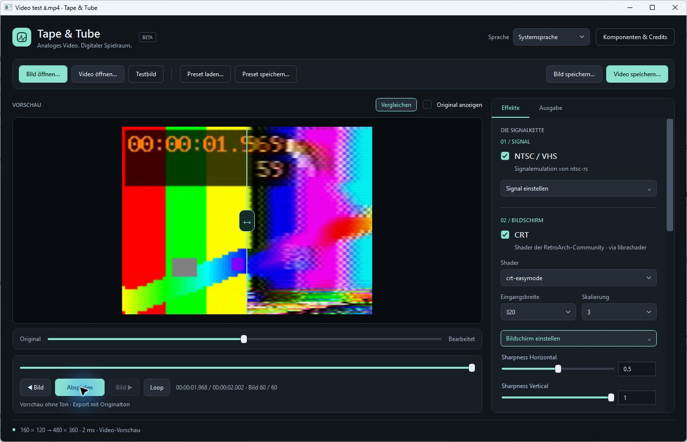

# Tape & Tube — Windows-Beta



**Windows-Adaption von [NTSCRT](https://github.com/finnmckenty/NTSCRT) von Finn McKenty.** Das ursprüngliche macOS-Projekt ist der Ausgangspunkt unserer Arbeit: Konzept, Aufbau der NTSC-/VHS- und CRT-Signalkette sowie der grundlegende Bedienablauf gehen auf NTSCRT zurück.

Tape & Tube setzt diesen Kern-Workflow mit einer neu geschriebenen Windows-Oberfläche in C#/WPF und einer Rust-Host-Anbindung um. Die Effektimplementierungen stammen aus **ntsc-rs** und den **RetroArch-CRT-Shadern über librashader**. Die Windows-Adaption deckt derzeit einen Teil der NTSCRT-Funktionen ab; der Swift-/Metal-Anwendungscode wird nicht übernommen.

Eigener Code: **GPL-3.0-only**, siehe `LICENSE` und `COPYRIGHT.md`. Die Urheberschaft am ursprünglichen Anwendungskonzept und Workflow liegt bei Finn McKenty / NTSCRT. Die lokale Veröffentlichungsvorbereitung und offene Punkte stehen in `RELEASE_REVIEW.md`.


## Download und Update-Kanäle

Den Windows-x64-Installer findest du unter https://github.com/emgeka/tape-and-tube/releases. Die .NET-Laufzeit ist enthalten. Das Setup prüft C++/DirectX und bietet bei Bedarf offizielle Microsoft-Downloads an. FFmpeg bleibt optional für Videos; ein vorhandenes Werkzeugpaar kann während der Installation ausgewählt werden.

Oben rechts unter **Updates** wählst du **Release** (stabile Versionen) oder **Beta** (einschließlich Vorabversionen). Die Auswahl bleibt gespeichert. Die App kann beim Start anonym auf GitHub nach neueren Versionen suchen und einen Hinweis zeigen; Download und Installation startest du selbst. Die automatische Prüfung lässt sich dort abschalten. Diese Beta startet im Beta-Kanal; eine stabile Version gibt es noch nicht. Details: [Update-Kanäle](UPDATE_CHANNELS.md).

## Fremdkomponenten und Konfiguration

**Komponenten & Credits** in der App erklärt den Anteil der externen Projekte, nennt ihre Quellen und Lizenzen und zeigt die tatsächlichen Bibliotheks-/Shader-/Medienwerkzeug-Pfade. Referenzversionen stammen aus `dependencies.json`; bei extern ersetzten DLLs wird nicht behauptet, deren Version entspreche automatisch dem getesteten Referenzstand. FFmpeg und ffprobe melden ihre tatsächlich installierte Version.

`components.json` enthält die gemeinsamen Voreinstellungen. Eine eigene Datei **`components.local.json`** kann einzelne Einstellungen überschreiben, ohne Anwendungscode oder die gemeinsamen Vorgaben zu ändern. Sie wird nicht in Quellcode- oder Veröffentlichungspakete aufgenommen. Pfade dürfen relativ zum Projekt-/Paketordner oder absolut sein:

```json
{
  "shaderRoot": "D:/Shaders/slang-shaders",
  "ffmpeg": "D:/MediaTools/ffmpeg.exe",
  "ffprobe": "D:/MediaTools/ffprobe.exe",
  "shaderPresets": ["crt/crt-easymode.slangp", "crt/crt-royale.slangp"]
}
```

Weitere Optionen: `ntscLibrary` und `librashaderLibrary`. Alternativ haben `TAPETUBE_SHADER_ROOT`, `TAPETUBE_NTSC_LIBRARY`, `TAPETUBE_LIBRASHADER_LIBRARY`, `TAPETUBE_FFMPEG` und `TAPETUBE_FFPROBE` Vorrang. Die NTSC-DLL benötigt unsere **Host-API 1**; librashader benötigt die unterstützte **ABI 2**. Ein generisches ntsc-rs-Plugin ist kein Ersatz für diese Host-DLL. Andere kompatible Bibliotheksstände sind technisch einbindbar, aber ihre Bildausgabe muss separat geprüft werden.

`shaderPresets` ist eine Liste relativer oder absoluter `.slangp`-Pfade. So lassen sich andere Presets einer vorhandenen Sammlung einbinden, ohne die Oberfläche umzuschreiben. Die ersten sieben Presets bleiben die getestete Voreinstellung. Fremde Shader werden nicht verändert oder unter unsere Lizenz umgestellt.

## Lokale Veröffentlichungsvorbereitung

`./scripts/package.ps1` erstellt eine portable Windows-x64-Ausgabe mit .NET-Laufzeit, eine bereinigte Quellcode-ZIP und Prüfsummen unter `artifacts/releases/`. Nach einmaligem Laden der Laufzeitpakete ist `-Offline` möglich. Der Pfad des jüngsten Pakets steht in `runtime/current-release.txt`.

Für das Erstellen der Veröffentlichungspakete ist zusätzlich Node.js erforderlich (Sammeln der Shader und Abhängigkeitsinformationen). Die fertige Anwendung benötigt Node.js nicht.

Der Stand wird als ausdrücklich gekennzeichnete **Beta mit Quellcode und Windows-Installer** veröffentlicht. Der Test zur Erkennung fehlender Microsoft-Komponenten auf einer frischen VM steht noch aus. VirtualBox-Exporte mit CRTSim können schwarze Bilder enthalten; derselbe Fall lief auf dem physischen Rechner korrekt. Ausgewählte Original-Shader werden einschließlich ihrer Dateien und vorhandenen Hinweise gesammelt; ungeklärte Lizenz-/Texturfragen werden im Prüfbericht nicht als gelöst ausgegeben. FFmpeg und persönliche Pfadkonfigurationen werden nicht mitkopiert. Weitere Angaben stehen in `RELEASE_README.md` und `RELEASE_REVIEW.md`.

`./scripts/test-package.ps1` entpackt die Ausgabe separat, prüft die enthaltene Laufzeit und die bereinigte Quellcode-ZIP, führt die vier Effekttests aus und testet zusätzlich eigene Bibliotheks-/Shaderpfade. Mit `-QaRoot` kann ein Verzeichnis außerhalb des Projekts gewählt werden. Der Test bestätigt den Paketbetrieb auf diesem Rechner; er ersetzt keinen Test auf einem frisch eingerichteten zweiten PC. Der derzeitige librashader-Build benötigt außerdem Microsoft-Visual-C++- und ältere DirectX-Laufzeitdateien; siehe `RELEASE_README.md`.

## Aktueller Umfang

- PNG, JPEG, BMP und TIFF öffnen.
- Originale NTSC-/VHS-Verarbeitung; Regler werden aus dem ntsc-rs-Schema erzeugt.
- Sieben CRT-Presets: easymode, aperture, hyllian, royale, crtglow_gauss, crtglow_lanczos, crtsim.
- CRT-Eingangsauflösung und Ausgabegröße einstellen; Shaderparameter bearbeiten.
- Verarbeitete Vorschau, Originalansicht, PNG-Export und eigene JSON-Presets.
- Videos öffnen, mit fortlaufenden NTSC-/CRT-Effekten abspielen und pausieren.
- Zeitleiste, Vor-/Zurück um ein Bild und PNG-Export des gewählten Videobildes.
- Loop-Schaltfläche zum Wiederholen der Video-Vorschau.
- MP4-Export (H.264, hohe Qualität) mit der ersten Original-Tonspur als AAC, Fortschrittsanzeige und Abbruch.
- Gemeinsame Ausgabegrößen für PNG und MP4: 720p, 1080p, 4K und eigene Maße; Einpassen mit schwarzen Rändern oder mittiger Beschnitt.
- Hintergrundberechnung mit verzögerter Aktualisierung beim Verschieben von Reglern.

Standbilder verwenden eine feste Frame-Nummer. Bei Videos folgen die Effekte der gewählten Videoposition. **Die Vorschau ist weiterhin ohne Ton; der MP4-Export enthält den Originalton.** Ein Windows-x64-Installer ist enthalten. NTSCRT-eigene Digitalvideo-, Glitch-, Screen-Loop- und Keyframe-Funktionen gehören nicht zum aktuellen Umfang.

## Starten

`Start.ps1` öffnet die zuletzt erfolgreich gebaute Version. Deren Ordner steht in `runtime/current-app.txt`. Neue Builds liegen getrennt unter `artifacts/builds/`, damit eine noch laufende ältere Version und ihre ungespeicherten Einstellungen beim Bauen erhalten bleiben.
Sie benötigt die Ordnerstruktur dieses Projekts und die enthaltenen Runtime-DLLs. Noch kein eigenständiges Installationspaket.

Alternativ in PowerShell im Projektordner:

```powershell
./Start.ps1
./Start.ps1 -Demo
```

Mit `-Demo` wird ein generiertes Testbild geladen. Transparente Bilder werden auf Schwarz zusammengesetzt.

## Oberfläche

Die große Vorschau steht links; **Original anzeigen** schaltet zum Vergleich auf die Quelle um. Rechts enthält **Effekte** die Signalstufen NTSC/VHS und CRT mit aufklappbaren Reglerlisten. **Ausgabe** bündelt Größe und Bildanpassung. **Bild speichern…** und **Video speichern…** stehen immer sichtbar oben rechts in der Werkzeugleiste. Die Breite der Seitenleiste lässt sich an der Trennlinie zur Vorschau anpassen. Bild, Video und Presets werden über die obere Werkzeugleiste geöffnet bzw. gespeichert.


**Vorher/Nachher:** Mit **Vergleichen** oberhalb der Vorschau werden links das Original und rechts die bearbeitete Ausgabe gleichzeitig sichtbar. Den vertikalen Trenner direkt im Bild ziehen oder den Regler darunter verwenden (auch per Pfeiltasten, Pos1/Ende). Das funktioniert bei Bildern und während der Video-Wiedergabe; beide Seiten zeigen dieselbe fertig berechnete Bildposition. Ausgabegröße, Einpassen und Beschnitt gelten für beide Seiten. **Original anzeigen** und der geteilte Vergleich schließen einander aus. Gespeicherte PNGs und MP4s enthalten ausschließlich die bearbeitete Ausgabe, ohne Trenner oder Vergleichsansicht.

## Sprache

Oben rechts stehen **Systemsprache** und zehn Sprachen zur Auswahl: Deutsch, English, Español, Français, Português (Brasil), Italiano, Русский, 简体中文 (vereinfachtes Chinesisch), 日本語 und 한국어. Die automatische Auswahl folgt der Windows-Anzeigesprache einschließlich regionaler Varianten; Portugiesisch wird pt-BR, Chinesisch wird zh-Hans zugeordnet. Für nicht unterstützte Sprachen wird Englisch verwendet. Die manuelle Wahl wird unter `%LOCALAPPDATA%/TapeTube/ui-settings.json` für künftige Starts gespeichert. Sie ist unabhängig von Medien, Presets und Komponentenpfaden.

Der Wechsel wirkt sofort und erhält das geladene Medium und die Effektwerte. Menüs, Hinweise, Status, Fortschritt und Credits sind übersetzt. Technische Effektparameter und originale Bibliotheksmeldungen bleiben im Original. Die Bedienelemente der nativen Windows-Dateidialoge folgen weiterhin der Windows-Sprache; Titel und Dateityptexte folgen der App-Sprache. Die zentralen Texte stehen in `src/Ntscrt.Windows/Translations.json` und werden in die Anwendung eingebettet. Alle zehn Sprachen haben einen vollständigen Katalog für die eigenen Anwendungstexte. Fachbegriffe aus den Fremdprojekten bleiben im Original.

`./scripts/test-language.ps1` prüft automatische Auswahl, Fallback, sofortige Aktualisierung der Sprachressourcen, unveränderte Zahlenkultur, Übersetzungsplatzhalter und das Speichern/Laden einschließlich defekter Einstellungsdateien.

## Ausgabegröße

Im rechten Reiter **Ausgabe** befindet sich **Ausgabegröße**. Die Schaltflächen für PNG und MP4 stehen oben rechts in der Werkzeugleiste. Die Auswahl gilt gleichermaßen für Vorschau, PNG und MP4:

- **Wie Vorschau** erhält die bisherige automatische Größe: ohne CRT die Quellauflösung, mit CRT die verkleinerte CRT-Eingangsauflösung multipliziert mit dem CRT-Skalierungsfaktor.
- **720p**, **1080p** und **4K** verwenden feste Maße von 1280 × 720, 1920 × 1080 beziehungsweise 3840 × 2160.
- **Eigene Maße** erlaubt eigene Breite und Höhe, etwa 1080 × 1920 für Hochkant. Zulässig sind ganze Zahlen von 1 bis 8192 Pixeln und zusammen höchstens 24 Megapixel.
- **Einpassen · schwarze Ränder** zeigt das vollständige Bild mit unverändertem Seitenverhältnis und ergänzt bei Bedarf Ränder.
- **Ausfüllen · mittig beschneiden** füllt das Zielformat ohne Verzerrung; überstehende Bildteile werden mittig abgeschnitten.

Die tatsächlichen Maße für PNG und MP4 stehen direkt darunter. PNG behält auch ungerade eigene Maße exakt bei; MP4 ergänzt nötigenfalls rechts beziehungsweise unten einen Randpixel für gerade Kodiermaße. Ungültige Maße sperren den Export, bis sie korrigiert sind.

Die CRT-Eingangsbreite bestimmt weiterhin die Retro-Auflösung und den Effektcharakter. Bei einer festen Ausgabegröße ist der frühere CRT-Skalierungsfaktor deaktiviert. Der CRT-Shader rendert unmittelbar in der für das Ziel benötigten Auflösung, damit Phosphormaske und Scanlines nicht bloß aus einem kleinen fertigen Bild hochskaliert werden. Die Vorschau berechnet ebenfalls diese Auflösung; 4K kann daher langsamer sein. Extrem große Beschnitt-Zwischenbilder werden auf die vorhandenen Textur- und Speichergrenzen begrenzt und anschließend angepasst.

Die Ausgabegröße und die Bildanpassung werden in eigenen Presets mitgespeichert. Bisherige Presets ohne diese Felder laden weiterhin mit automatischer Ausgabegröße.

## Video-Vorschau

Über **Video öffnen…** ein Video wählen, dann **Abspielen** drücken. **Loop** wiederholt die Vorschau vom Anfang, bis sie pausiert oder Loop ausgeschaltet wird. Die Zeitleiste sowie **◀ Bild** und **Bild ▶** pausieren die Wiedergabe und wählen ein einzelnes Bild. Sobald dessen Effekte fertig berechnet sind, wird **Bild speichern…** oben rechts freigegeben. Während der Wiedergabe bleibt PNG-Export deaktiviert, damit keine unklare Position exportiert wird.

Bei hoher Last überspringt die Wiedergabe Bilder, um der Spielzeit zu folgen. Das gewählte pausierte Bild wird vollständig verarbeitet. Variable Bildraten werden für diese erste Vorschau auf die durchschnittliche Bildrate vereinheitlicht; die Bildnummern beziehen sich auf dieses Vorschau-Zeitraster. Rotation und Pixel-Seitenverhältnis werden beim Dekodieren berücksichtigt. Die Vorschau ist für SDR ausgelegt; eine gesonderte HDR-Tonwertumsetzung ist nicht enthalten.

Der Dekoder hält nur ein Bild im Cache und streamt die folgenden Bilder. Rückwärtssprünge dekodieren erneut vom Anfang und können deshalb bei langen Videos dauern. Währenddessen bleiben die Bedienelemente nutzbar; ein neuer Suchvorgang bricht den bisherigen ab.

FFmpeg und ffprobe werden als unsichtbare lokale Hilfsprozesse genutzt. Auf diesem Rechner ist FFmpeg bereits vorhanden und in `runtime/media-tools.json` eingetragen. Auf einem anderen Rechner FFmpeg bereitstellen und `./scripts/setup-media.ps1` ausführen. Alternativ `NTSCRT_FFMPEG` und `NTSCRT_FFPROBE` auf die EXE-Dateien setzen oder beide nach `runtime/media/` legen. Es werden keine Videos hochgeladen.

## Videoexport

**Video speichern…** oben rechts speichert das gesamte geladene Video mit den beim Start gewählten Effekten als H.264-MP4 (CRF 18, 8 Bit, YUV 4:2:0, SDR BT.709). Dabei wird jedes Bild auf dem gleichen Zeitraster wie in der Vorschau berechnet. Bei variabler Quellbildrate wird dieses Raster auch im Export verwendet. Die erste Tonspur wird als AAC mit 192 kbit/s übernommen; weitere Tonspuren und Untertitel werden nicht exportiert. Videos ohne Ton bleiben ohne Ton.

Ein später Toneinsatz bleibt erhalten. Ton vor dem ersten Videobild wird abgeschnitten; fehlender Ton am Ende wird durch Stille ergänzt. Ungerade Bildmaße erhalten rechts beziehungsweise unten höchstens einen schwarzen Randpixel, damit H.264-kompatible gerade Abmessungen entstehen.

Während des Exports sind die Einstellungen gesperrt. Fortschritt und Restzeitschätzung werden angezeigt; **Abbrechen** beendet den Vorgang. Die Ausgabe wird zunächst in einer temporären Datei im Zielordner erzeugt und erst nach erfolgreichem Abschluss unter dem gewählten Namen abgelegt. Bei Abbruch bleibt eine bereits vorhandene Zieldatei unverändert. Das Quellvideo selbst lässt sich nicht als Exportziel wählen. Beim Schließen der App wird ein laufender Export abgebrochen und aufgeräumt.

Die Loop-Schaltfläche betrifft ausschließlich die Vorschau; der Export enthält das Video einmal.

## Bauen

Windows x64, Direct3D-11-fähige Grafikkarte und .NET Desktop Runtime 10 werden vorausgesetzt. Das Setup lädt SDK, Rust, Compiler und Shader lokal nach `.tools` beziehungsweise `assets`. Git muss verfügbar sein. Keine globalen PATH-Änderungen erforderlich.

```powershell
./scripts/setup.ps1
./scripts/setup-media.ps1
./scripts/build.ps1
./scripts/test.ps1
./scripts/test-video.ps1
./scripts/test-export.ps1
./scripts/test-output.ps1
```

Wenn alle Abhängigkeiten bereits geladen sind: `./scripts/build.ps1 -Offline`.

## Prüfung

`--smoke` berechnet ein synthetisches Testbild mit den echten Bibliotheken auf Direct3D 11. Die 16 Prüfungen umfassen unveränderten Bypass, sichtbare NTSC-Verarbeitung, deterministische NTSC-Ausgabe bei fester Frame-Nummer, CRT-Ausgabegröße und -Parameter, nichtleere CRT-Ausgabe, die kombinierte Kette, verlustfreien PNG-Roundtrip, Ablehnung ungültiger Einstellungen und erfolgreiche Ausgabe aller sieben CRT-Presets.

Ergebnisse stehen in `artifacts/smoke.json`; `source.png`, `ntsc.png`, `crt.png` und `combined.png` zeigen die Stufen. Ein erfolgreicher Test belegt noch keine Pixelgleichheit mit der Mac-App oder Kompatibilität mit jeder Grafikkarte.

`--video-smoke` erzeugt kurze Testvideos mit FFmpeg und prüft gebrochene und variable Bildraten, Unicode-Dateipfade, sequenzielles Lesen gegenüber Positionssprüngen, Videoende, Abbruch, Hochkant-Metadaten, zeitabhängige Effekte und den PNG-Export eines Videobildes. Ergebnisse stehen in `artifacts/video-smoke.json` und `artifacts/video-frame.png`.

`--export-smoke` prüft H.264/AAC, tatsächliche Bildanzahl und Bildrate, sichtbare Effektverarbeitung, Farbkennzeichnung, Audio-Zeitversatz und hörbaren Toneinsatz, Videos ohne Ton, variable und gebrochene Bildraten, ungerade Bildgrößen, Fortschritt sowie Abbruch und Schutz vorhandener Dateien. Ergebnisse stehen in `artifacts/export-smoke.json`; Beispiele unter `artifacts/export-fixtures/`.

`--output-smoke` prüft Einpassen und Beschnitt ohne Verzerrung, Ränder, Mittelung feiner Muster beim Verkleinern, Maße und Validierung, Ausgabe unabhängig vom CRT-Skalierungsfaktor, direktes CRT-Rendering in Zielauflösung sowie PNG und MP4 mit festen, ungeraden und Hochkantmaßen. Beispiele bis 4K liegen unter `artifacts/output-fixtures/`, der Bericht in `artifacts/output-smoke.json`.

## Architektur und Versionsstände

- `native/`: kleine eigene C-Schnittstelle um unverändertes ntsc-rs; Einstellungen und Reglerbeschreibungen werden als JSON übertragen. Keine Rust-Panics über die Sprachgrenze.
- `src/Ntscrt.Windows/`: WPF-Oberfläche, Bildimport/-export und serialisierte Effektkette.
- `VideoSource`: FFmpeg-Streaming-Dekoder, FFprobe-Metadaten und abbrechbare Positionssprünge. Decoderzugriffe sowie Grafikzugriffe sind jeweils serialisiert. Die Wiedergabe wird durch eine monotone Uhr gesteuert.
- `VideoExporter`: eigener Dekoder und eigene Effektkette mit eingefrorenen Einstellungen; fortlaufende BGRA-Bilder über eine Pipe an FFmpeg. Ton wird relativ zum ersten Video-Zeitstempel ausgerichtet. Begrenzter Speicherbedarf, keine komplette Bildsequenz auf der Festplatte.
- Die CPU verarbeitet NTSC vor dem GPU-Upload. Dadurch entfällt für Standbilder ein GPU-Readback vor ntsc-rs. Die CRT-Ausgabe wird für Vorschau und PNG wieder ausgelesen.
- `dependencies.json` hält die Ursprungsprojekte und Versionen fest; `native/Cargo.lock` hält die Rust-Abhängigkeiten fest.
- librashader **0.12.0**, ABI 2. Bewusster eigener Ausgangsstand; keine Behauptung identischer Ausgabe zum älteren, von NTSCRT verwendeten Commit.
- Eigene Windows-Presets mit Formatkennung `ntscrt-windows`, Version 1. Vollständige NTSCRT-Look-Dateien werden nicht importiert.

## Nächster Ausbau

1. Bedienung und Bildqualität anhand echter Bildquellen verbessern; weitere Grafikkarten prüfen.
2. Schnellere Positionssprünge und Vorschau auf längeren Videos verbessern.
3. Exportqualität und weitere Grafikkarten mit realem Material prüfen, anschließend paketierte Windows-Ausgabe.

## Herkunft

Siehe `THIRD_PARTY.md`. Tape & Tube ist eine eigenständig gepflegte Windows-Adaption und keine offizielle Ausgabe der Fremdprojekte.


